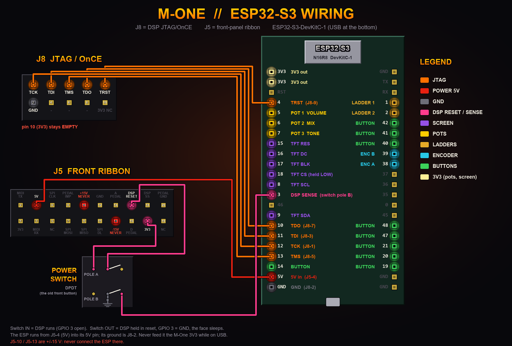
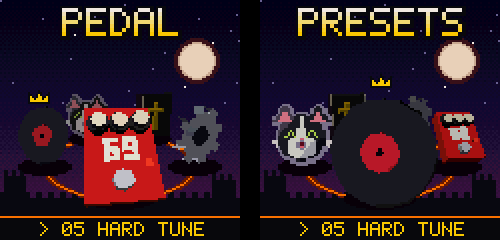
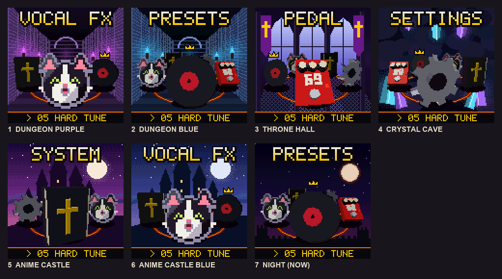
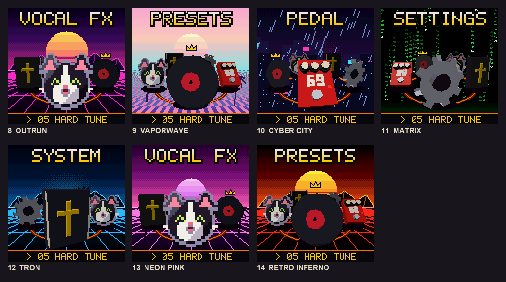
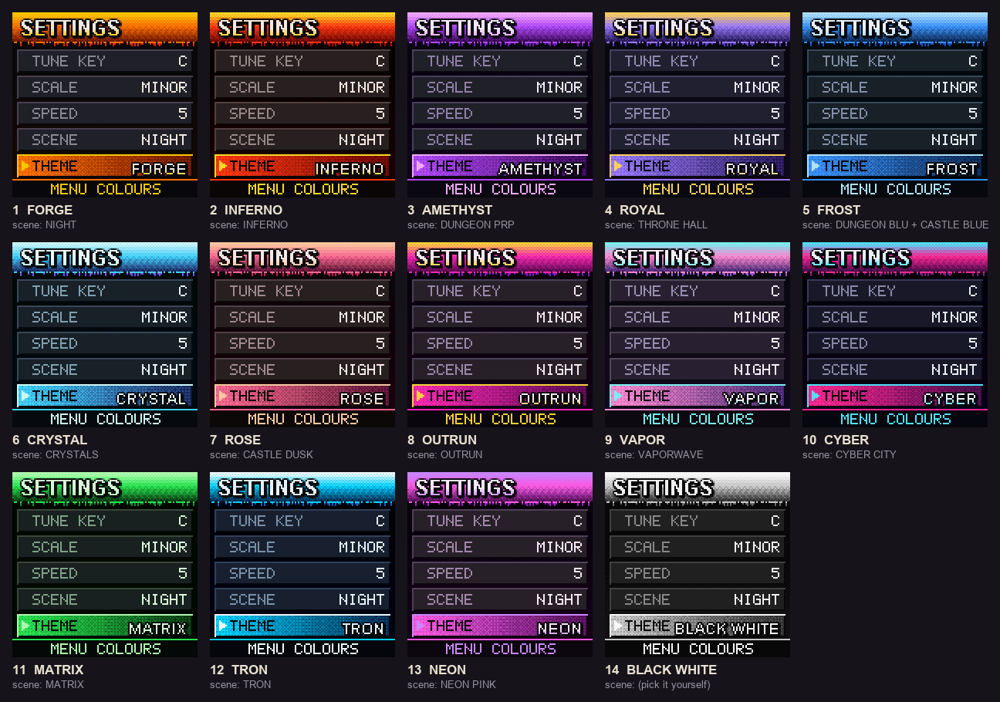

# M-One Rack: screen + new OS mod

A new brain and a new OS for the **TC Electronic M-One** (plain M-One, mainboard P16001-4/-3). An ESP32-S3 takes over:
it talks to the M-One's **Motorola DSP56362** through the DSP's own debug port (J8, JTAG/OnCE), loads new DSP programs
straight into the DSP's RAM, and drives a colour screen. The TC front panel and its dead segment LCD are no longer
needed for the new effects.

**Discord:** come hang out, ask questions and share builds: https://discord.gg/R3CQkFdRtf

What runs today: our own DSP code on the M-One. A passthrough, a simple distortion, a **heavy distortion** (tighten,
three gain stages, soft clip, cab-ish filter) and a **reverse delay** with feedback, tempo-synced chunks and a
triangle swell. Every effect is a small Python script that writes DSP machine code. A change is a 10-second reload,
with no flashing.

**Legal:** this repo contains no TC Electronic code or ROM data. You dump **your own** unit's flash, and the tools work
on your dump locally. Don't share dumps or disassembly listings: share this repo instead.

## Wiring

Pin tables and the button ladders are in [`USER_GUIDE.md`](USER_GUIDE.md). The picture is drawn by
`tools/draw_wiring.py`; rerun it if the wiring changes.

**Using it:** [`USER_GUIDE.md`](USER_GUIDE.md).

**Working on it with an AI model (or by hand)?** Start with [`how-to-reverse-engineer/`](how-to-reverse-engineer/README.md).

**Quick start:** wire the ESP32-S3 to J8 (6 wires), flash `firmware/mone_dev`, run `python tools/fetch_opcodes.py`,
power the M-One on normally, then `python dsp/revdelay.py` and `python tools/mone.py COMx load revdelay.hex` +
`python tools/mone.py COMx go A00`.

## How it works
- **J8 = the DSP's JTAG/OnCE port.** The ESP bit-bangs JTAG: it reads the DSP ID, halts the core, runs single
  instructions, and reads or writes any memory. That is enough to dump the flash, peek at live registers, and load and
  start new programs. It's non-destructive: nothing is written to the flash.
- **New DSP code lives in internal P RAM at `P:$0A00`.** The ESP writes it word by word over OnCE, reads it back to
  verify, and jumps to it (OnCE GO-TO). If it crashes, power-cycle and you're back on the stock firmware.
- **Audio path:** ADC = ESAI RX1, DAC = ESAI TX1, 2 slots per frame, clocked by the board. A program waits for
  "receive data full" (SAISR bit 8), processes the sample and writes TX1.
- **Memory for delays:** 128K x 24-bit external SRAM (X:$020000-$03FFFF) and 1M x 16 DRAM (X/Y:$200000).
- **For now TC's own boot sets up the clocks and ESAI.** Power on normally, then load. Our own init (standalone boot)
  is on the TODO list.
- **Un-muting without the front panel:** TC's firmware keeps the outputs muted until its front panel says otherwise.
  `dsp/codec_on.py` (run by `boot`) writes the AK4524's run values and drives MUTE* (PB12) **low**. Despite its name,
  that pin mutes when high or open (schematic page 9, "open=mute"); TC itself runs with it low.

## Effects
| Script | What | Status |
|---|---|---|
| `dsp/passthrough.py` | ADC -> DAC, nothing else | **hardware** (heard) |
| `dsp/distortion.py` | +48 dB in two saturating stages, cubic soft clip, -24 dB out | **hardware** |
| `dsp/heavy.py` | ~360 Hz tighten HPF, +60 dB over three clip stages, soft clip, ~4.2 kHz LPF, mono out | **hardware** |
| `dsp/revdelay.py` | reverse delay: 1 beat @ 92 BPM chunks, triangle window, feedback 0.55, dry/2 + wet, +12 dB | **hardware** ("coolest reverse I've heard") |
| `dsp/compressor.py` | servo compressor: peak env, -20 dBFS threshold, ~20 ms attack, ~0.45 s release, +12 dB makeup (no division needed) | built + verified, not heard yet |

Each script prints its own disassembly (so every opcode is checked) and writes a `.hex` that `tools/mone.py load` sends.
Tweak the constants at the top (BPM / chunk length, feedback, wet, gains) and reload.

## The OS kernel (`dsp/os.py`) and the FX page
One DSP program holds every effect as a subroutine (sample in X1, out in X1) plus a routing kernel:
- **SINGLE**: IN > FX1 > OUT
- **DOUBLE**: FX1 and FX2 in parallel, mixed
- **DOUBLE-SINGLE**: FX1 into FX2 in series (e.g. heavy into reverse)

Mode, FX1 and FX2 live at X:$20/$21/$22. The ESP's **FX page** (`firmware/mone_dev/menu.h`) changes them live over J8:
it halts the DSP, saves X0, writes the param, restores X0 and resumes (a sub-millisecond blip). Effect ids: 0 clean,
1 heavy, 2 reverse, 3 comp, 4 tune, 5 vox (vocal chain, `dsp/vocal.py`). Status: **on hardware.** `mone.py boot` starts it with the outputs un-muted
(test tone heard on the analog outs, kernel running), and the FX page switches effects live.

## Screen
A 1.54" 240x240 ST7789 IPS on the ESP32-S3 (LovyanGFX). The front panel UI runs on it: FX, TUNE and SYSTEM pages
(live inputs, WiFi IP and signal), a BUTTON TEST page, and an idle uwu face. 14 buttons (learned by position), 3 pots and
an encoder. WiFi serial and OTA flashing, so no USB is needed once it's racked. Wiring and controls are in `USER_GUIDE.md`.

It boots to a low-poly 3D MODE ring (software-rendered, PS1 style): VOCAL FX, PRESETS, PEDAL, SETTINGS, SYSTEM. EXIT
steps back one page at a time and remembers where you were. The pictures are renders from the mockup scripts, drawn the
same way the firmware draws them.

SETTINGS > SCENE swaps the background behind the ring (14 scenes, kept across reboots):

SETTINGS > THEME sets the menu colours: MATCH SCENE, or any of 14 fixed themes.

## Files
| Path | What |
|---|---|
| `firmware/mone_dev/` | ESP32-S3 sketch: J8 JTAG/OnCE (ID, halt, registers, P/X/Y memory read, flash dump, program load + go), the screen, and the old J5 SPI-boot tools |
| `tools/mone.py` | PC side: `jid`, `regs`, `jdump`, `pmem`/`xmem`/`ymem`, `load`, `go`, `screen` (needs pyserial) |
| `tools/dis56k.py` | table-driven DSP56300 disassembler |
| `tools/fetch_opcodes.py` | downloads the GPL opcode table and builds `opcodes56300.json` locally (not committed) |
| `tools/build_app.py` | rebuilds and disassembles the stock app from your own flash dump -> `dumps/app.lst` (not committed) |
| `dsp/*.py` | the effects |
| `FLASH_MAP.md` | flash format, loader, memory map, peripheral init values, audio path |
| `FRONT_PROTOCOL.md` | how the stock DSP talks to the front panel AVR over J5 |
| `how-to-reverse-engineer/` | the briefing for continuing the work |
| `dumps/` | put your own flash dump here (never committed) |

## Dumping your own flash
`python tools/mone.py COMx jdump dumps/m1_flash_a.bin`, twice, then compare. The dump forces `M0` linear and re-sends
the read instruction for every byte (see `how-to-reverse-engineer/PITFALLS.md` for why). A good dump parses: every
loader section ends exactly where the next one starts (`tools/build_app.py` shows the blocks).

## TODO
- Standalone boot: our own PLL/AAR/ESAI/codec init so TC's firmware never has to run (then the front panel can go).
  With the front panel removed, J5 pin 16 (DSP_RESET) must be held high.
- Programs stored on the ESP and auto-loaded when the power button turns the DSP on (today `mone.py boot` from a PC).
- Pots mapped to effect parameters.
- More effects: latency test.
- Chain effects (heavy -> reverse) in one program; two-head reverse for a constant-level wash.

## Credits and legal
By **JunkSmithWizard (JSW)** with Claude (Anthropic). The DSP opcode table is fetched at build time from the
GPL-3.0 [dsp56300 emulator](https://github.com/dsp56300/dsp56300) (thanks to its authors). DSP56362 / DSP56300 facts
are from the public Motorola/Freescale manuals. TC Electronic and M-One are trademarks of their owners. This project
is not affiliated with them. No TC code, ROM data or service documents are included. MIT licence (see `LICENSE`).
